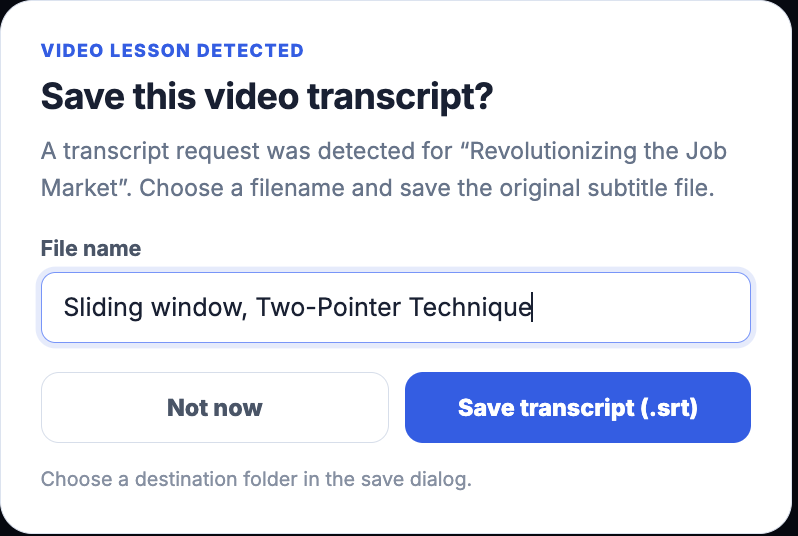
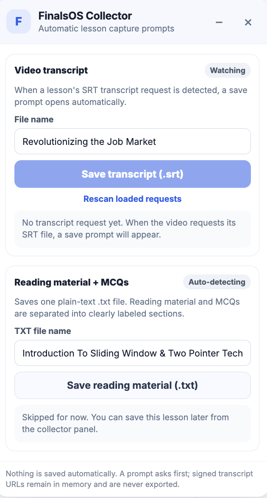

<<<<<<< HEAD
# FinalsOS Course Collector

A local-first Chrome extension that asks before saving course video transcripts and exports reading lessons as clean, structured `.txt` study notes.

> **Status:** Personal-use project. Tested with static syntax/manifest checks; live course-page behavior can vary as the learning platform's markup changes.

## Features

- **Transcript prompts:** Detects SRT transcript requests from the configured media host and asks before saving. The filename is editable.
- **Reading prompts:** Detects supported reading lesson containers and asks before exporting.
- **Readable text exports:** Formats headings, paragraphs, lists, tables, alerts, inline code, and code examples rendered in Ace editor blocks.
- **MCQs in a separate section:** Separates recognized question wrappers from the reading text and places their detected options in a clearly labeled section. It does not guess answer keys.
- **Filename control:** Exports transcripts as `.srt` and reading notes as `.txt` using the edited filename.
- **One-click enable/disable:** The toolbar popup contains an ON/OFF switch for automatic save prompts.
- **No automatic file saving:** A user confirmation is required for each export.
- **Local-first behavior:** No telemetry, analytics, external AI calls, or uploads of captured lesson content are implemented.

## Screenshots

### Transcript save prompt



### Extension settings



## Install in Chrome

1. Download this repository as a ZIP and extract it, or clone it with Git.
2. Open `chrome://extensions`.
3. Turn on **Developer mode**.
4. Click **Load unpacked**.
5. Select the repository folder containing `manifest.json`.
6. Reload any already-open course tabs.
7. Click the extension toolbar icon to enable or disable **Automatic save prompts**.

To update an existing local installation, replace the old source files with the new version and click **Reload** on `chrome://extensions`.

## How to use

### Video transcript

1. Leave **Automatic save prompts** switched ON.
2. Open a supported video lesson and play/load it so the lesson requests its transcript.
3. When an SRT request is detected, the extension opens a save prompt.
4. Edit the filename, then choose **Save transcript** or **Not now**.

### Reading material

1. Open a supported reading lesson.
2. When the reading content is detected, choose whether to save it.
3. Edit the filename and save the `.txt` document.
4. Review the `READING MATERIAL` section and the separate `MCQ PRACTICE QUESTIONS` section.

Some course code examples are loaded or expanded dynamically. The exporter attempts to expand supported code-block controls before capture. If the platform doesn't expose the full code in the rendered DOM, some material may still require manual verification.

## Supported page layouts

The content script currently looks for these reading containers:

- `.tutorial-content-container`
- `[data-testid="text-learning-card"]` with nested Markdown content

It excludes feedback wrappers whose class contains `SubmitFeedbackButtonWrapper` and recognizes question blocks whose class contains `TutorialContentMcqQuestionWrapper`.

The transcript observer is restricted to SRT files under:

`https://nkb-backend-ccbp-media-static.s3.amazonaws.com/media/transcripts/`

The course content script is restricted to pages matching `https://learning.ccbp.in/*`. Selectors and request patterns may need updating if the site changes.

## Project structure

```text
finalsos-course-collector/
├── .github/
│   └── workflows/
│       └── check-extension.yml
├── screenshots/
│   ├── extension-settings-popup.png
│   └── transcript-save-prompt.png
├── scripts/
│   └── check-extension.mjs
├── background.js
├── content.js
├── manifest.json
├── popup.html
├── popup.js
├── CHANGELOG.md
├── CONTRIBUTING.md
├── SECURITY.md
└── README.md
```

## Permissions

- `storage`: remembers the automatic-prompt ON/OFF preference locally in Chrome extension storage.
- `webRequest`: detects requests for configured course transcript resources.
- Host permission for the configured transcript media host: allows the extension service worker to fetch the SRT contents for saving.
- Content script match for `https://learning.ccbp.in/*`: allows the extension to inspect supported reading containers on course pages.

No broad `cookies`, `history`, or all-sites access is requested.

## Privacy and safe handling

- A file is created only after you confirm in a save prompt.
- Signed S3 transcript URLs are handled in runtime memory and are not written to study-file metadata or logs by the extension.
- Captured reading content and transcripts are not uploaded to a server by this project.
- The only persisted extension preference is whether automatic prompts are enabled.
- Keep signed request URLs, cookies, authorization headers, and personal course information out of public issues and screenshots.

## Development checks

Requires Node.js. No npm dependencies are needed.

```bash
node scripts/check-extension.mjs
```

The check validates the Manifest V3 structure, required source-file references, and JavaScript syntax.

## Limitations

- This is a Chrome Manifest V3 extension; other browsers are not currently tested.
- It depends on the selectors and transcript URL pattern described above.
- MCQ choices are extracted from recognizable visible option elements; layout variations may require selector updates.
- The extension does not determine correct answers or capture hidden answer keys.
- A platform update can change DOM structure or request behavior. Re-test exports after significant site changes.

## Project status and affiliation

This is an independent study utility and is not affiliated with or endorsed by CCBP, NxtWave, or the learning platform. Use it only with content you are authorized to access and save, and follow your institution's rules.

## License

No license is included yet. Unless the repository owner adds a license, reuse, redistribution, and derivative works are not automatically granted. Choose a license before inviting outside contributions or redistribution.
=======
# Finalos-course-collector
>>>>>>> b10131e32b4f26af084ac760c985bf7d39544087
